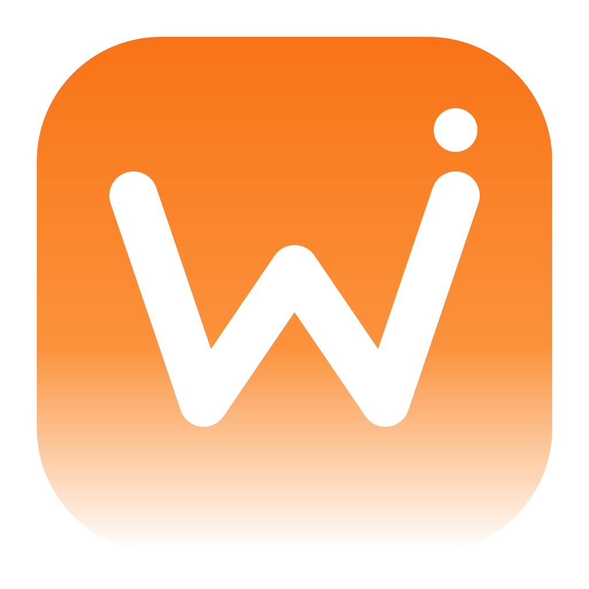

# Wiek Browser

简体中文 · [English](README.md)



本地 Chromium 浏览器与 Agent 工作区，提供自动化标签组、隔离的浏览器用户配置、文件/Git 工具、自动化调度与浏览器控制。Electron 宿主和本地服务采用独立实现，SDK 使用自身构建与 Wiek 运行命名空间，无需安装其他浏览器；第三方许可与署名保留在 [NOTICE.md](NOTICE.md)。

**当前检查点：0.30.0。功能覆盖与验收仍在推进。** 参见[计划](PLAN.md)、[能力矩阵](analysis/implementation-matrix.md)和[验证结果](reports/RESULTS.md)。

在 **设置 → 界面语言** 中可以选择跟随系统、简体中文或 English。设置即时生效，并在下次启动时保留。

## 本地运行

```sh
git clone https://github.com/YeohsCode/Wiek-Browser.git
cd Wiek-Browser
npm ci
npm --prefix packages/sdk ci --ignore-scripts
npm run build:sdk
npm run build:desktop-native
npm start
```

原生 helper 与当前发行包面向 macOS ARM64。浏览器控制与本地工具不需要云端账号；模型驱动的 Agent 执行需要独立配置 Agent 程序。

```sh
node cli/wiek-browser.mjs install
node cli/wiek-browser.mjs start
node cli/wiek-browser.mjs skill
node cli/wiek-browser.mjs status
node cli/wiek-browser.mjs stop
```

`WIEK_DATA_DIR=/absolute/path` 用于启动隔离实例。开发数据默认保存在 `data/`，打包版使用 `~/Library/Application Support/Wiek Browser/`。已有兼容资料原地复用，不自动移动或删除；OS 绑定的加密凭据和系统权限需要单独迁移验收。

## 功能

- 标签、自动化标签组、隔离的浏览器用户配置、书签、历史、下载、站点权限和用户接管。
- JavaScript SDK：snapshot、locator、输入、iframe、截图、上传/下载与 CDP。
- Agent 工作区：审批、附件、会话分支、已接入的原生适配器与模型目录。
- 项目文件、Git、审核式远程操作及支持 linked worktree 隔离的项目文件备份。
- **项目本地服务**：刷新监听进程、打开回环地址、显式读取页面标题、审核并确认停止。停止前复核启动身份、目录、可执行文件和端口；发现过程不请求网页、不读取进程参数或环境。
- MCP 传统/现代 stdio 与 HTTP 连接、作用域工具/资源、订阅、只读提示预览、审核式 OAuth 与有界输入续传。
- 加密浏览器数据备份为每个标签页保留最多 64 条前进和后退记录，并可迁移所选标签页的 local/session storage 和有界 IndexedDB 数据，保留自增主键的下一值，也支持共享引用、循环引用、稀疏数组、二进制视图和 Blob/File 附件。旧版归档仍可读取。
- 自动化调度、显式后台作业、执行模式、忙碌延期、运行记忆/结果和崩溃恢复。
- 收藏文件夹、截图标注、网页/指定应用操作记录、显式桌面采集、本地转写与离线翻译。

本地服务发现需要 macOS helper，只列出目录属于所选项目的监听进程。受保护进程及未支持的 runtime 不能停止；忽略终止信号的进程仍显示为运行，不自动升级为强制停止。

## 浏览器控制

```sh
node cli/wiek-browser.mjs nodejs <<'JS'
const task = await taskSpace('research');
const page = task.page('p1');
await page.goto('https://example.com');
console.log(await page.snapshot());
JS
```

同一任务在浏览器持续运行时复用任务 ID 与页面标识。独立测试可使用不同任务名和隔离数据目录。重启后重新识别标签页。术语与具体操作见[术语表](docs/terminology.md)及[易用性审计](reports/usability-audit.md)。本地工作区接口参见 [API 指南](skills/wiek-browser/API.md)。

启动时只打开一个空白标签页可用 `wiek-browser start --no-restore`。下次正常启动仍可重开之前保存的标签页，浏览器资料继续可用。

## 可选本地模型

打包语音功能前恢复固定身份的语音模型：

```sh
node tools/fetch-speech-model.mjs
```

下载身份和许可见[模型说明](models/MODEL-NOTICE.md)。翻译依赖与模型安装在选定数据目录：

```sh
node cli/wiek-browser.mjs translation install --python /absolute/path/to/python3.12 --pairs en-zh,zh-en,en-es,es-en
```

源码与打包服务已通过中英、中西双向四个合成样例，推理期间禁止 socket 连接。这是有界功能验收，不是通用质量分数；Python 和翻译权重单独安装。

## 验证与打包

```sh
npm test
npm run test:upstream
npm run test:e2e -- --browser wiek
npm run test:workbench
npm run dist
```

应用位于 `dist/mac-arm64/Wiek Browser.app`。配置发行凭据前，它仍是未签名、未公证的本地构建。[CI](.github/workflows/wiek-ci.yml) 从干净检出执行 SDK、本地、原生 helper、框架、打包宿主和浏览器检查。

69 项本地浏览器测试与 31 项线上模型任务分别记录。线上评估需要相同模型、思考、限额及专用测试账号，目前未运行。参见[共享适配器说明](benchmark/sdk-v2/README.md)和[当前结果](reports/RESULTS.md)。

剩余工作包括更完整的资料迁移、MCP 后续流程、语义记忆、其他 provider、最终原生设备验收与签名发布。物理睡眠/登录、多显示器、实际撤权和真实账号工作流均与合成测试分别记录。

## 许可

Wiek 原创实现采用 MIT 许可；SDK、runtime、解码器和模型保留各自许可与署名。运行数据、凭据、依赖、构建产物、模型权重、参考制品及完整研究记录不进入 Git。
